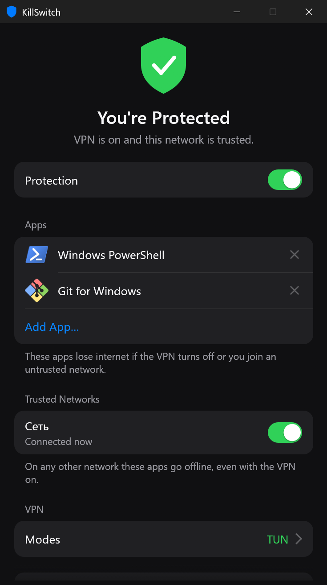
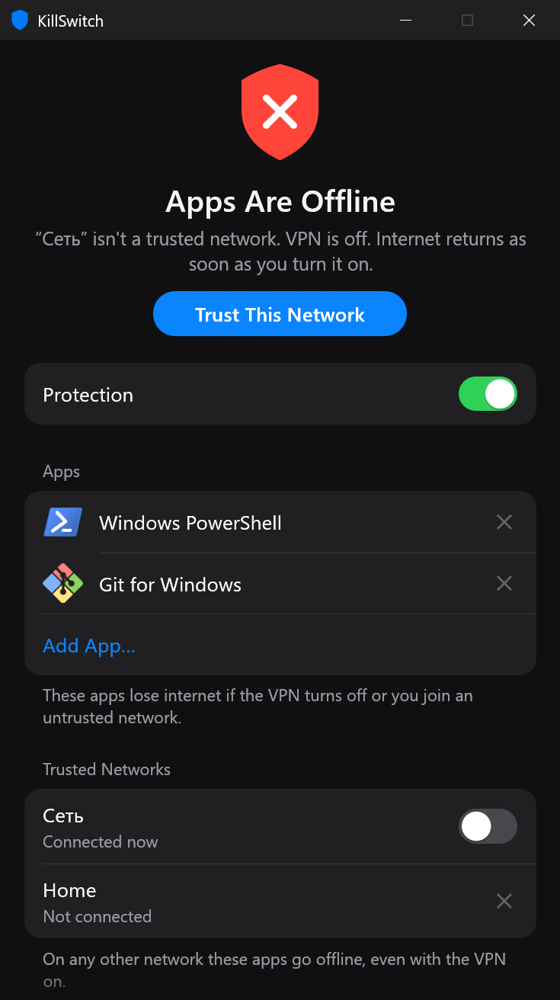
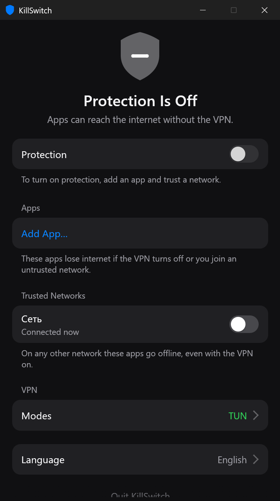

<div align="center">

# KillSwitch

**Per-app internet kill switch for Windows.**
Selected apps lose internet the moment your VPN drops or you join a network you don't trust.

[](https://github.com/BazZziliuS/KillSwitch/actions/workflows/ci.yml)
[](https://github.com/BazZziliuS/KillSwitch/releases)
[](https://github.com/BazZziliuS/KillSwitch/releases)


[](LICENSE)

English · [Русский](README.ru.md)

| Protected | Apps cut off | Off |
| :---: | :---: | :---: |
|  |  |  |

</div>

## Features

- **Choose the apps.** Pick from what's open or browse to any `.exe`. Everything else keeps its normal connection.
- **Choose the sites.** Listed domains become unreachable from every app except your VPN client while protection is blocking.
- **Finds related addresses.** When you add a site, KillSwitch reads it through the VPN and offers its subdomains and the services it uses.
- **Exclusions.** Regular expressions keep unwanted domains out of the search results and out of blocking. A plain word matches anywhere in the domain.
- **Allowed servers.** Optionally, apps and sites go offline when the VPN moves to a server you haven't allowed. Servers can be given names.
- **Notifications and a banner.** Windows notifications say when apps are cut off or back online, and a banner appears over an offline app while it's in front.
- **IPv6 leak guard.** If IPv6 would go around the tunnel, it's turned off for the selected apps.
- **Starts with Windows.** Optional, straight to the tray and without a UAC prompt.
- **Update check.** Tells you when a new release is out. Nothing is downloaded automatically.
- **Trusted networks.** On any other network the selected apps go offline, even with the VPN on.
- **VPN awareness.** Works with TUN mode and system proxy mode in clients such as [Throne](https://github.com/throneproj/Throne) and Happ.
- **Other tunnels don't count.** Tailscale and similar adapters are not mistaken for your VPN.
- **Automatic recovery.** Internet returns by itself once the conditions are met again.
- **Fails closed.** If the network state can't be read, the apps are blocked. A block survives a crash or reboot.
- **Lives in the tray.** The tray icon shows the current state at a glance.
- **English and Russian.** Follows the Windows display language, or choose one in the app.

## Getting started

1. Download `KillSwitch-windows-x64.exe` from [Releases](https://github.com/BazZziliuS/KillSwitch/releases) and run it. Windows will ask for administrator rights, which are required to manage network filters.
2. Add the apps to protect.
3. Mark your current network as trusted.
4. Turn on **Protection**.

If your VPN's TUN adapter isn't recognized, enable TUN in the VPN client and select the adapter under **VPN → Modes**. Throne's `throne-tun` adapter is selected by default.

Closing the window keeps KillSwitch running in the tray. Quitting from the app or the tray menu lifts all blocks.

## How it works

| Condition | Result |
| --- | --- |
| Trusted network and VPN on | Apps are online |
| Connected network isn't trusted | Apps are blocked |
| No network | Apps are blocked |
| Every selected VPN mode is off | Apps are blocked |
| Server check is on and the server isn't allowed or can't be determined | Apps are blocked |

- **TUN** counts as on when the selected adapter is up and the route to the internet goes through it.
- **System proxy** counts as on when Windows has a proxy set on this computer and something is listening on its port.
- **Blocking** uses persistent [Windows Filtering Platform](https://learn.microsoft.com/windows/win32/fwp/windows-filtering-platform-start-page) filters keyed to each executable. Unlike firewall rules, these also cover loopback, which is how apps reach a local proxy.
- **Sites** are blocked by IP address. Addresses are looked up about once a minute while protection is on, and more often during a block, then remembered in `%APPDATA%\KillSwitch\sites.json`.
- **Server check** is off by default. When on, KillSwitch asks [ipify](https://www.ipify.org) or [icanhazip](https://icanhazip.com) for your public address through the VPN about every 15 seconds and compares it with your allowed list. Those services see only your VPN's address.

## Known limitations

- Blocking reacts to a change, so a very short leak window exists: near-instant for adapter and route changes, up to 0.3 s when the system proxy is switched off.
- Only the selected executable is blocked. If an app does its networking in a separate `.exe`, add that one too.
- While blocked, an app also loses access to `127.0.0.1`.
- Site blocking works on addresses, so sites sharing a CDN address go offline together, and a site can briefly load from an address not seen yet. Only the domain and its `www` address are covered. Non-Latin domains must be entered in punycode.
- A server is identified by its public address. If the VPN changes server without restarting the tunnel, the change is noticed at the next check, up to 15 s later. A server with several exit addresses needs each one allowed.
- Protection only applies while KillSwitch is running, apart from a block already in place. Turn on **Start with Windows** to cover logon.
- The search for related addresses reads a site's page and scripts as text and runs no code, so hosts computed in JavaScript at run time aren't found.
- The banner can't appear over games in exclusive fullscreen.

## Command line

| Option | Purpose |
| --- | --- |
| `--unblock` | Remove all blocks left behind while the app isn't running |
| `--status` | Print detected networks, adapters and block reasons, without admin rights |
| `--dry-run` | Run the full app without admin rights and without writing any filter |
| `--autostart` | Start in the tray without opening the window |

## Building from source

Requires Windows and a recent stable Rust toolchain.

```sh
cargo test
cargo build --release
```

The binary is written to `target/release/KillSwitch.exe`.

Settings are stored in `%APPDATA%\KillSwitch\config.json`.

### Project layout

| Path | Contents |
| --- | --- |
| `src/protection` | Block rules and the background monitor |
| `src/platform` | Windows APIs: filtering, network state, running apps |
| `src/ui` | Window, pages, widgets and tray icon |
| `src/i18n.rs` | All interface text |

## License

[PolyForm Noncommercial 1.0.0](LICENSE). Free for personal and other noncommercial use. Commercial use is not permitted.

---

Not affiliated with Throne or Happ.
