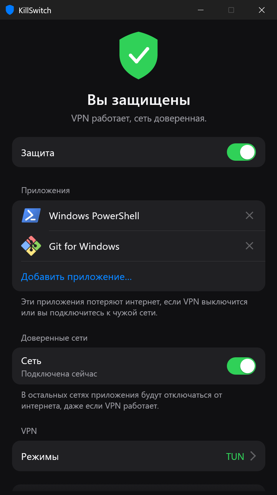
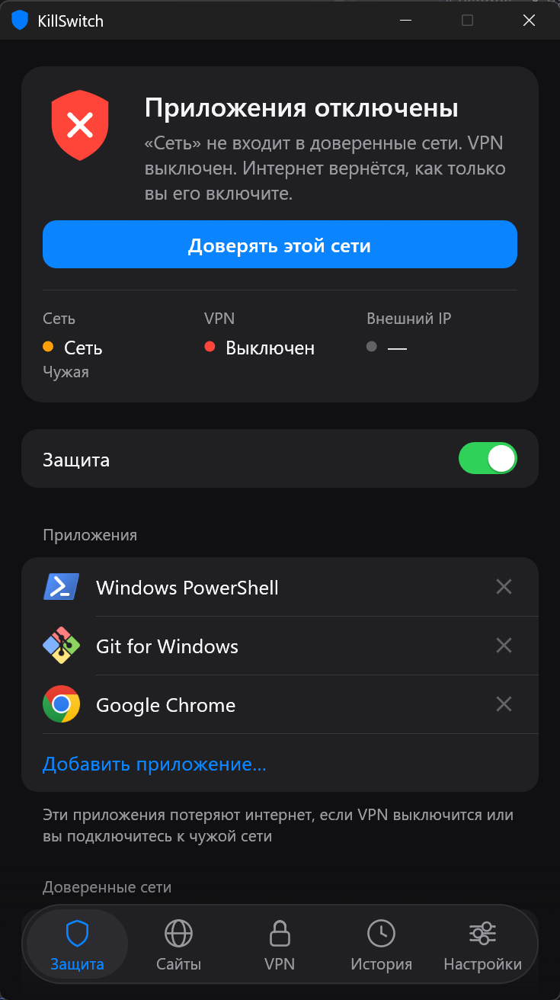
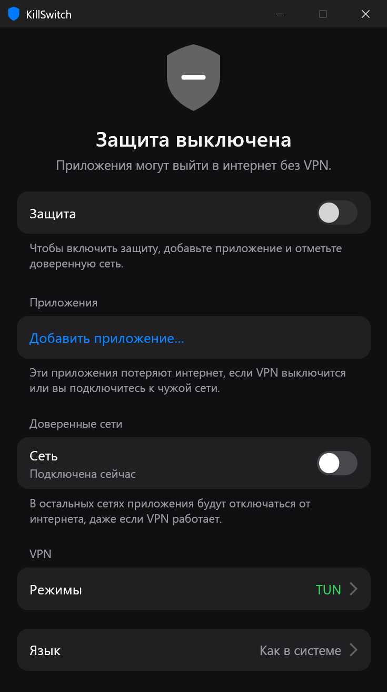

<div align="center">

# KillSwitch

**Kill switch для отдельных приложений в Windows.**
Выбранные приложения теряют интернет, как только падает VPN или вы подключаетесь к сети, которой не доверяете.

[](https://github.com/BazZziliuS/KillSwitch/actions/workflows/ci.yml)
[](https://github.com/BazZziliuS/KillSwitch/releases)
[](https://github.com/BazZziliuS/KillSwitch/releases)


[](LICENSE)

[English](README.md) · Русский

| Защита активна | Приложения отключены | Защита выключена |
| :---: | :---: | :---: |
|  |  |  |

</div>

## Возможности

- **Выбор приложений.** Выбирайте из открытых или укажите любой `.exe`. Остальные программы работают как обычно.
- **Доверенные сети.** В любой другой сети выбранные приложения отключаются, даже если VPN включён.
- **Режимы VPN.** Поддерживаются TUN и системный прокси в клиентах вроде [Throne](https://github.com/throneproj/Throne) и Happ.
- **Другие туннели не считаются.** Tailscale и похожие адаптеры не принимаются за ваш VPN.
- **Автоматическое восстановление.** Интернет возвращается сам, как только условия снова выполнены.
- **Безопасно при сбое.** Если состояние сети определить не удалось, приложения блокируются. Блокировка переживает сбой и перезагрузку.
- **Работает в трее.** Значок показывает текущее состояние.
- **Русский и английский.** Язык определяется по Windows, его можно выбрать в приложении.

## Как начать

1. Скачайте `KillSwitch-windows-x64.exe` со страницы [Releases](https://github.com/BazZziliuS/KillSwitch/releases) и запустите. Windows запросит права администратора: они нужны для управления сетевыми фильтрами.
2. Добавьте приложения.
3. Отметьте текущую сеть как доверенную.
4. Включите **Защиту**.

Если TUN-адаптер вашего VPN не определился, включите TUN в клиенте и отметьте адаптер в разделе **VPN → Режимы**. Адаптер `throne-tun` от Throne выбран по умолчанию.

При закрытии окна KillSwitch продолжает работать в трее. Выход из приложения или из меню трея снимает все блокировки.

## Как это работает

| Условие | Результат |
| --- | --- |
| Доверенная сеть и VPN включён | Приложения в сети |
| Подключена сеть не из списка | Приложения заблокированы |
| Нет сети | Приложения заблокированы |
| Все отмеченные режимы VPN выключены | Приложения заблокированы |

- **TUN** считается включённым, если выбранный адаптер поднят и маршрут в интернет идёт через него.
- **Системный прокси** считается включённым, если в Windows задан прокси на этом компьютере и его порт кто-то слушает.
- **Блокировка** использует постоянные фильтры [Windows Filtering Platform](https://learn.microsoft.com/windows/win32/fwp/windows-filtering-platform-start-page), привязанные к файлу приложения. В отличие от правил брандмауэра, они действуют и на loopback, через который приложения обращаются к локальному прокси.

## Известные ограничения

- Блокировка реагирует на изменение, поэтому короткое окно утечки существует: почти мгновенно при смене адаптера или маршрута, до 0,3 с при отключении системного прокси.
- Блокируется только выбранный файл. Если приложение работает с сетью через отдельный `.exe`, добавьте и его.
- На время блокировки приложение теряет и доступ к `127.0.0.1`.
- Автозапуска с Windows пока нет. Защита работает, только пока запущено приложение, если не считать уже действующей блокировки.

## Командная строка

| Параметр | Назначение |
| --- | --- |
| `--unblock` | Снять все блокировки, оставшиеся без запущенного приложения |
| `--status` | Показать найденные сети, адаптеры и причины блокировки, без прав администратора |
| `--dry-run` | Запустить приложение без прав администратора и без записи фильтров |

## Сборка из исходников

Нужны Windows и свежий стабильный Rust.

```sh
cargo test
cargo build --release
```

Готовый файл: `target/release/KillSwitch.exe`.

Настройки хранятся в `%APPDATA%\KillSwitch\config.json`.

### Структура проекта

| Путь | Содержимое |
| --- | --- |
| `src/protection` | Правила блокировки и фоновый монитор |
| `src/platform` | API Windows: фильтрация, состояние сети, запущенные приложения |
| `src/ui` | Окно, экраны, виджеты и значок в трее |
| `src/i18n.rs` | Все тексты интерфейса |

## Лицензия

[PolyForm Noncommercial 1.0.0](LICENSE). Бесплатно для личного и другого некоммерческого использования. Коммерческое использование запрещено.

---

Проект не связан с Throne и Happ.
